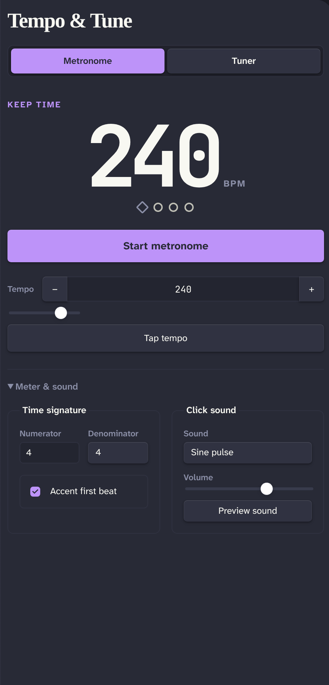

# Metronome + Tuner

<picture>
  <source media="(prefers-color-scheme: dark)" srcset="docs/brand/mark-mono-dark.svg">
  
</picture>

[SUBCULT](https://subcult.tv) · [Support on Patreon](https://patreon.com/subcult)

Metronome + Tuner is an [Obsidian](https://obsidian.md) plugin that adds a metronome and a chromatic tuner in a side view, so you can practise with your notes open. It works in Obsidian 1.7.2 or later on desktop and mobile. The current release is 1.3.0, and the plugin is listed in Obsidian's community plugins.



## Features

- Metronome from 30 to 300 BPM with tap tempo, time signatures from 1 to 16 beats over 2, 4, 8 or 16, an optional first-beat accent, volume, and seven click sounds (woodblock, mechanical, rimshot, claves, cowbell, soft digital, sine pulse).
- Chromatic tuner that shows the note, its frequency, how many cents sharp or flat you are, and how confident the reading is.
- A4 reference adjustable from 415 to 466 Hz.
- Keyboard-accessible tabs and controls. Space starts and stops the metronome when focus is not on a control.
- Interface in English, German, Spanish, French, Croatian, Italian, Dutch, Polish, Brazilian Portuguese and Simplified Chinese. It follows Obsidian's language by default, and you can pick a language in settings without restarting.
- Commands: **Open**, **Start metronome** and **Stop metronome**.

### Microphone and privacy

The tuner asks for microphone access only after you select **Use microphone**. It analyses the audio on your device and does not record, store, send or play it. Whether the microphone is available depends on your device, operating system and the Obsidian mobile app.

## Quick start

### Install from Obsidian

1. Open **Settings → Community plugins**.
2. Select **Browse**, search for **Metronome + Tuner**, and select **Install**.
3. Select **Enable**.

### Install manually

Download `main.js`, `manifest.json` and `styles.css` from a [release](https://github.com/PatrickFanella/obsidian-plugin-metronome-tuner/releases) and copy them into:

```text
<vault>/.obsidian/plugins/metronome-tuner/
```

Restart Obsidian, then enable **Metronome + Tuner** under **Settings → Community plugins**.

### Use it

Select the ribbon icon or run the **Open** command to open the **Tempo & tune** view.

- **Metronome:** set the tempo or use **Tap tempo**, adjust **Meter & sound**, then select **Start metronome**.
- **Tuner:** select **Use microphone**, allow access, and play one clear note near the microphone. Select **Stop listening** when you are done.

## Configuration

Startup defaults live under **Settings → Metronome + Tuner**: language (`auto` by default), tempo (120 BPM), time signature (4/4), accent (on), volume, click sound (woodblock) and the A4 reference (440 Hz). Obsidian saves them in the plugin's `data.json` in your vault.

## Build from source

Node.js 24 or later is required.

```bash
npm install
npm run dev     # watch the source and write main.js at the repository root
npm run build   # production main.js
```

Other scripts:

| Script | What it does |
| --- | --- |
| `npm run lint` | ESLint, including the Obsidian plugin rules. |
| `npm test` | Vitest unit tests. |
| `npm run typecheck` | TypeScript type check. |
| `npm run build:clean` | Remove any existing `main.js`, then build. |
| `npm run check` | Lint, tests, type check and a clean build. |
| `npm run verify:release -- x.y.z` | `check`, then validate the version metadata and built files for that tag. |

### Releases

1. Set the same `x.y.z` version in `package.json`, `manifest.json` and `versions.json` (`npm version` updates the last two).
2. Run `npm run verify:release -- x.y.z`.
3. Push a tag named exactly `x.y.z`, without a `v` prefix.
4. The release workflow builds the files and creates a draft GitHub release with `main.js`, `manifest.json` and `styles.css`. Check the draft, then publish it.

## Project layout

| Path | Contents |
| --- | --- |
| `src/main.ts` | Plugin entry, commands and ribbon icon. |
| `src/view.ts` | The **Tempo & tune** view. |
| `src/metronome/` | Scheduler, click synth, tap tempo and sound presets. |
| `src/tuner/` | YIN pitch detector, note maths and the tuner controller. |
| `src/audio/` | Shared audio runtime. |
| `src/settings.ts`, `src/settingsParsing.ts` | Settings tab and validation. |
| `src/i18n.ts`, `src/i18n/` | Translations and locale detection. |
| `styles.css` | View styles. |
| `tests/` | Vitest tests. |

## Contributing

Report bugs and request features in [GitHub issues](https://github.com/subculture-collective/obsidian-plugin-metronome-tuner/issues). Send code as pull requests on GitHub against `main`. CI runs `npm run check` (lint, tests, type check and a clean build) on every pull request. For anything else, email [patrick@subcult.tv](mailto:patrick@subcult.tv).

## License

[MIT](LICENSE). Made by Patrick Fanella as part of [SUBCULT](https://subcult.tv).
